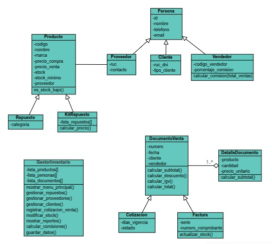

# Sistema de Control de Inventario y Cotizaciones de Repuestos

**Caso: Ferreyros S.A. — Grupo 2**
Fundamentos de Programación 2 (1FIS0275) · Ciclo 2026-02 · UPC
Docente: Juan Carlos Fernández Sánchez

Prototipo por consola, escrito en Python con programación orientada a objetos, que
apoya el proceso de **cotización y venta de repuestos**: catálogo de repuestos y kits,
proveedores y clientes, cotizaciones con descuento e IGV, emisión de boleta o factura,
control de stock con alertas y reporte de comisiones.

## Cómo ejecutarlo

Requiere **Python 3.9 o superior**. No usa librerías externas.

```
git clone https://github.com/willy6711s/fp2-inventario-ventas-grupo2
cd fp2-inventario-ventas-grupo2

python main.py            # inicia el menú principal
python main.py test       # ejecuta las pruebas unitarias
```

En Mac o Linux, usar `python3` en lugar de `python`.

## Estructura del proyecto

```
fp2-inventario-ventas-grupo2/
├── main.py                       # clases, menú principal y pruebas unitarias
├── README.md
└── docs/
    ├── diagrama_de_clases.png    # diagrama de clases del sistema
    └── historias_usuario.md      # las 16 historias de usuario del informe
```

## Diagrama de clases



## Reglas de negocio

| Regla                    | Valor                                                    |
| ------------------------ | -------------------------------------------------------- |
| IGV                      | 18 %                                                     |
| Descuento por volumen    | 5 % cuando el subtotal supera S/ 900                     |
| Comisión del vendedor    | 2 % sobre las ventas netas                               |
| Validez de la cotización | 15 días                                                  |
| Comprobante              | Factura si el cliente tiene RUC; boleta si tiene DNI     |
| Moneda                   | Soles (S/)                                               |

## Conceptos de POO aplicados

| Concepto             | Dónde se ve                                                                                                                           |
| -------------------- | ------------------------------------------------------------------------------------------------------------------------------------- |
| **Herencia**         | `ItemRepuesto → RepuestoIndividual, KitRepuesto` · `Persona → Cliente, Vendedor` · `Documento → Cotizacion, Boleta, Factura`           |
| **Polimorfismo**     | `obtener_tipo()`, `obtener_rol()`, `descuenta_stock()` y `obtener_identificador()` se comportan distinto en cada subclase             |
| **Abstracción**      | `ItemRepuesto`, `Persona` y `Documento` son clases abstractas (`ABC`)                                                                 |
| **Encapsulamiento**  | Atributos privados (`__`) con `@property`; las listas de `SistemaFerreyros` solo se modifican por sus métodos                         |
| **Composición**      | `Documento` contiene varios `DetalleCotizacion`                                                                                       |
| **Excepciones**      | `ExcepcionInventario` se lanza cuando el stock es insuficiente y se captura en el menú                                                |

## Pruebas unitarias

`python main.py test` ejecuta 8 pruebas (`unittest`) sobre los métodos de negocio:
cálculo de montos con y sin descuento, stock insuficiente, cotización que no descuenta
stock, factura que sí lo descuenta, creación de factura (RUC) o boleta (DNI) y
comisión del vendedor.

## Estado de las historias de usuario

| Estado                  | Historias                                                                                    |
| ----------------------- | -------------------------------------------------------------------------------------------- |
| Implementadas           | HU01, HU02, HU04, HU05, HU06, HU07, HU08, HU09, HU10, HU12                                   |
| Con datos de ejemplo    | HU11, HU13, HU14 (el menú de reportes muestra valores de ejemplo, aún no se calculan)        |
| Pendientes              | HU03 (modificar y dar de baja), HU15 (historial), HU16 (guardar y cargar en archivo)         |

El detalle de cada historia está en [`docs/historias_usuario.md`](docs/historias_usuario.md).

## Equipo — Grupo 2

| Integrante                       | Código     | Responsabilidad principal                                                   |
| -------------------------------- | ---------- | --------------------------------------------------------------------------- |
| Max Francisco Ponce Huaman       | U202526210 | Empresa, problema, generalidades y coordinación del informe                 |
| Junior Antonio Chavez Correa     | U202619576 | Proceso AS-IS y diagrama de clases                                          |
| Anthony Jeremy Astohuayhua Valle | U20261E777 | Alternativas de solución, proceso TO-BE y diagrama de clases                |
| Ariana Stefany Rojas Solis       | U20261A212 | Historias de usuario, diseño de pantallas, bibliografía y pruebas           |
| Willy Leonardo Siccha Delgado    | U202614280 | Diagrama de flujo, cronograma en Trello, evidencias e informe final         |
